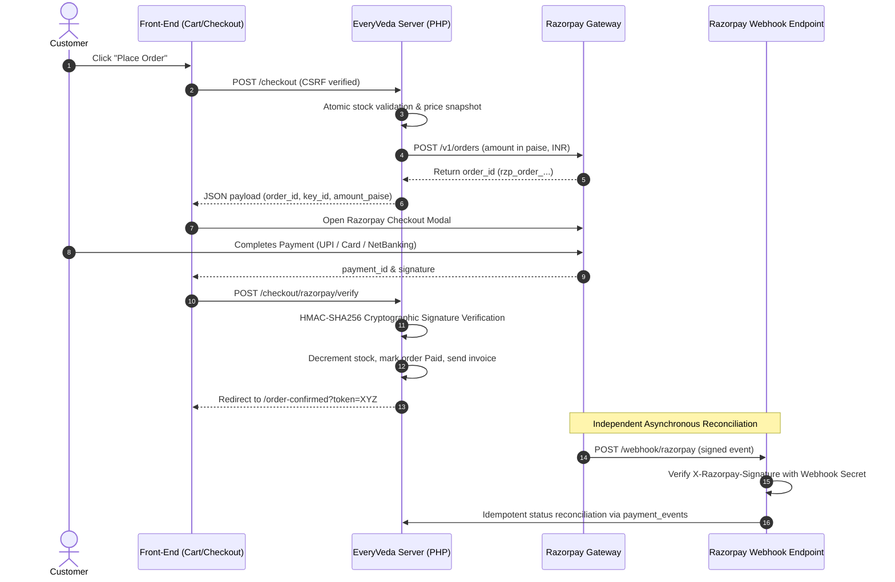

# EveryVeda.com — Core PHP E-Commerce Platform

Production-ready, highly secure, bilingual (Hindi & English), responsive Ayurvedic wellness e-commerce platform built with **Core PHP 8.2+ and MariaDB/MySQL (Zero Frameworks)**, engineered specifically for deployment on standard cPanel shared hosting and cloud environments.

---

## 1. System Overview & Technology Stack

| Component | Specification |
| :--- | :--- |
| **Backend Architecture** | Core PHP 8.2+ (Native PSR-4 Autoloading, Custom MVC Engine, Zero Framework Overhead) |
| **Database** | MariaDB 10.4+ / MySQL 8.0+ (InnoDB, UTF-8 Multilingual `utf8mb4_unicode_ci`, Strict Foreign Keys) |
| **Database Layer** | PHP Data Objects (PDO) with prepared statements, strict parameter binding, atomic transactions |
| **Frontend UI/UX** | HTML5, CSS3, Bootstrap 5.3, Bootstrap Icons, Vanilla JavaScript (ES6+), Mobile-First |
| **Design System** | Forest Green (`#214D36`), Botanical Green (`#477A52`), Cream (`#FAF7EF`), Muted Gold (`#C6A45C`), Dark Text (`#26332B`) |
| **Typography** | Inter (English) & Noto Sans Devanagari (Hindi) |
| **Payment Gateway** | Official Razorpay API Integration (Paise Conversion, Server-Side HMAC-SHA256, Idempotent Webhooks) |
| **Hosting Target** | cPanel Shared Hosting (Apache 2.4+ with `mod_rewrite`, `mod_headers`, `mod_deflate`, PHP 8.2+) |

---

## 2. Directory Structure

```text
EveryVeda/
├── app/
│   ├── bootstrap.php                   # Bootstrapper (PSR-4 Autoloader, Env loader, Error handler)
│   ├── Controllers/                    # MVC Controllers
│   │   ├── AccountController.php       # Customer authentication, profile, addresses, orders
│   │   ├── BlogController.php          # Ayurvedic wellness blog
│   │   ├── CartController.php          # Cart operations, coupon redemption
│   │   ├── CatalogController.php       # Search, filter, sorting, pagination
│   │   ├── CheckoutController.php      # Order placement, Razorpay verification, COD
│   │   ├── HomeController.php          # Dynamic homepage sections, banners, bestsellers
│   │   ├── LanguageController.php      # English / Hindi locale switcher
│   │   ├── OrderTrackingController.php # Privacy-safe public order tracking
│   │   ├── PageController.php          # Policy & CMS pages, contact form, newsletter
│   │   ├── ProductController.php       # Product detail, pack size variants, pincode check, reviews
│   │   ├── RazorpayWebhookController.php # Cryptographic webhook handler & status reconciliation
│   │   ├── SitemapController.php       # Dynamic XML sitemap for Google & search engines
│   │   └── Admin/                      # Protected Administrative Control Panel
│   │       ├── AuthController.php      # Admin login, session locking, audit logging
│   │       ├── CategoryController.php  # Category & subcategory management
│   │       ├── ContentController.php   # Banners, blog posts, and CMS policies
│   │       ├── CouponController.php    # Promotional coupon engine
│   │       ├── CustomerController.php  # Customer directory & lifetime spend
│   │       ├── DashboardController.php # Financial analytics & order KPIs
│   │       ├── OrderController.php     # Order fulfillment, courier tracking, status state machine
│   │       ├── ProductController.php   # Product catalog & pack size variants
│   │       ├── ReportController.php    # CSV exports with formula injection mitigation
│   │       ├── ReviewController.php    # Product review moderation queue
│   │       └── SettingController.php   # Store settings, taxes, shipping, Razorpay credentials
│   ├── Core/                           # Architectural Core
│   │   ├── Controller.php              # Base controller with CSRF, validation, view rendering
│   │   ├── Database.php                # PDO singleton, query builder helpers, transaction manager
│   │   ├── Request.php                 # Sanitized HTTP request abstraction
│   │   ├── Response.php                # JSON, redirect, CSV, and secure header response helper
│   │   ├── Router.php                  # Regex URL router with parameter capture & middleware
│   │   └── View.php                    # Layout and template rendering engine
│   ├── Helpers/
│   │   └── functions.php               # Global helper library (e(), __(), format_inr(), csrf_field(), etc.)
│   ├── Middleware/
│   │   ├── AdminAuthMiddleware.php     # Admin session guard & permission verification
│   │   ├── AuthMiddleware.php          # Customer session authentication guard
│   │   └── CsrfMiddleware.php          # Synchronizer token pattern CSRF defense
│   ├── Models/
│   │   ├── Banner.php                  # Hero banner model
│   │   ├── BlogPost.php                # Blog post and translation model
│   │   ├── Category.php                # Category and hierarchy model
│   │   ├── Order.php                   # Order, tracking, and item snapshot model
│   │   └── Product.php                 # Product catalog, variants, and review model
│   ├── Services/
│   │   ├── AdminAuthService.php        # Admin login brute force throttle & security audit log
│   │   ├── AuthService.php             # Customer registration, bcrypt login, password reset
│   │   ├── CartService.php             # Guest & persistent cart, variant inventory validation
│   │   ├── CheckoutService.php         # Atomic transaction order placement & reconciliation
│   │   ├── CouponService.php           # Coupon rule engine (usage limits, thresholds)
│   │   ├── InventoryService.php        # Stock reservations, deductions, and cancellation restoration
│   │   ├── InvoiceService.php          # GST-compliant printable tax invoice generator
│   │   ├── MailerService.php           # Transactional HTML notification emails
│   │   ├── RazorpayService.php         # Official Razorpay API, HMAC-SHA256 signature verification
│   │   ├── ReportService.php           # Formula-injection-safe CSV generator
│   │   ├── ShippingService.php         # Indian PIN code delivery check & shipping rules
│   │   ├── TaxService.php              # GST 12% calculation (Intrastate CGST+SGST vs Interstate IGST)
│   │   └── TranslationService.php      # Bilingual string localization manager
│   └── Views/                          # View Templates (Organized by domain & admin)
├── database/
│   ├── schema.sql                      # 38 InnoDB tables with full UTF8mb4 & foreign keys
│   ├── seed.sql                        # Authentic Ayurvedic products, variants, coupons, policies
│   └── migrate.php                     # Database migration & seed runner
├── public/
│   ├── .htaccess                       # Apache rewrite rules & browser caching
│   ├── index.php                       # Front Controller entrypoint
│   ├── robots.txt                      # Search engine crawler instructions
│   └── assets/                         # Public stylesheets, scripts, and vector assets
├── resources/
│   └── lang/
│       ├── en.php                      # Comprehensive English localization dictionary
│       └── hi.php                      # Comprehensive Hindi (हिंदी) localization dictionary
├── routes/
│   └── web.php                         # Route definitions
├── scripts/
│   ├── backup.php                      # Automated database backup and GZIP compressor
│   ├── generate_assets.php             # Brand artwork generator
│   └── test_runner.php                 # Automated CLI test suite runner
├── storage/
│   ├── backups/                        # Compressed database dumps
│   ├── cache/                          # Temporary application cache
│   ├── invoices/                       # Generated tax invoices
│   └── logs/                           # Error and audit logs
├── tests/
│   └── Unit/
│       ├── CartTest.php                # Financial calculations, GST, shipping, coupons
│       ├── DatabaseSanityTest.php      # Database connection & seed integrity
│       ├── RazorpaySignatureTest.php   # Cryptographic payment & webhook HMAC-SHA256
│       └── SecurityTest.php            # XSS escaping, CSV sanitization, CSRF, tokens
├── .env.example                        # Template environment configuration
└── composer.json                       # Composer dependencies & PSR-4 declaration
```

---

## 3. Database Architecture (38 InnoDB Tables)

The database schema (`database/schema.sql`) adheres to relational 3NF normalization, full `utf8mb4_unicode_ci` multilingual collation, and atomic foreign keys:

1. **RBAC & Administration:** `admin_roles`, `admin_permissions`, `role_permissions`, `admin_users`, `admin_audit_logs`.
2. **Customer Identity:** `users`, `customer_addresses`, `password_reset_tokens`.
3. **Catalog & Taxonomy:** `categories`, `category_translations`, `products`, `product_translations`, `product_variants`, `product_images`.
4. **Cart & Wishlist:** `carts`, `cart_items`, `wishlists`, `wishlist_items`.
5. **Promotions & Coupons:** `coupons`, `coupon_redemptions`, `coupon_categories`, `coupon_products`.
6. **Order Fulfillment:** `orders`, `order_items`, `order_status_history`, `shipments`.
7. **Payments & Ledger:** `payments`, `payment_events`, `refunds`.
8. **CMS & Engagement:** `banners`, `homepage_sections`, `pages`, `page_translations`, `blog_posts`, `blog_translations`, `contact_enquiries`, `newsletter_subscribers`, `product_reviews`.
9. **Configuration:** `settings`.

---

## 4. Local Development Setup

### Prerequisites
- PHP 8.2 or higher with `pdo_mysql`, `curl`, `mbstring`, `json`, `gd`, and `zlib` extensions enabled.
- MariaDB 10.4+ or MySQL 8.0+.

### Step-by-Step Installation

1. **Clone the repository:**
   ```bash
   git clone <repo-url> EveryVeda
   cd EveryVeda
   ```

2. **Configure Environment:**
   Copy `.env.example` to `.env`:
   ```bash
   cp .env.example .env
   ```
   Open `.env` and verify database credentials:
   ```ini
   APP_NAME="EveryVeda"
   APP_ENV="local"
   APP_DEBUG=true
   APP_URL="http://localhost:8000"

   DB_HOST="127.0.0.1"
   DB_PORT=3306
   DB_NAME="everyveda_db"
   DB_USER="root"
   DB_PASS=""
   ```

3. **Initialize Database & Seed Data:**
   Run the native PHP migration script:
   ```bash
   php database/migrate.php
   ```
   This executes `database/schema.sql` (creating all 38 tables) and `database/seed.sql` (populating 8 authentic Ayurvedic products, variants, English/Hindi translations, coupons, banners, and default settings).

4. **Start Local Development Server:**
   ```bash
   php -S localhost:8000 -t public
   ```

5. **Access the Storefront & Admin:**
   - **Public Storefront:** [http://localhost:8000](http://localhost:8000)
   - **Admin Control Panel:** [http://localhost:8000/admin](http://localhost:8000/admin)
   - **Default Admin Login:**
     - **Email:** `admin@everyveda.com`
     - **Password:** `Admin@12345`

6. **Run Automated Test Suites:**
   ```bash
   php scripts/test_runner.php
   ```

---

## 5. cPanel Shared Hosting Deployment Guide

### Deployment Options

#### Option A: Dedicated Subdomain or Addon Domain (Recommended)
1. In cPanel, navigate to **Domains** &rarr; **Create A Domain**.
2. Set the **Document Root** to `/home/username/public_html/EveryVeda/public` (pointing directly to the `public/` directory).
3. The root directory remains above the web root, preventing direct web access to application code, `.env`, and database files.

#### Option B: Standard `public_html` Root Deployment
If your hosting plan restricts Document Root changes:
1. Upload the entire project into `/home/username/public_html/`.
2. The root `.htaccess` file automatically routes incoming traffic to `/public/` while securing sensitive directories (`/app`, `/database`, `/storage`, `/config`, `/routes`, `.env`) with HTTP 403 Forbidden rules.

### Detailed Deployment Steps

1. **Upload Files:**
   - Compress the project (excluding `.git` and `vendor` if using Git) into a zip file.
   - Upload via cPanel **File Manager** into your designated folder and extract.

2. **Create MySQL Database & User:**
   - Navigate to cPanel **MySQL Database Wizard**.
   - Create database (e.g. `cpaneluser_everyveda`).
   - Create user (e.g. `cpaneluser_vedauser`) and generate a strong password.
   - Assign user to database with **ALL PRIVILEGES**.

3. **Import Database Schema & Seeds:**
   - Open cPanel **phpMyAdmin**.
   - Select your database and click **Import**.
   - Import `database/schema.sql`, followed by `database/seed.sql`.
   - *Alternatively, run `php database/migrate.php` via SSH terminal.*

4. **Configure Production `.env`:**
   In cPanel File Manager, edit `.env`:
   ```ini
   APP_NAME="EveryVeda"
   APP_ENV="production"
   APP_DEBUG=false
   APP_URL="https://everyveda.com"

   DB_HOST="localhost"
   DB_NAME="cpaneluser_everyveda"
   DB_USER="cpaneluser_vedauser"
   DB_PASS="YourStrongPasswordHere"

   RAZORPAY_MODE="live"
   RAZORPAY_KEY_ID="rzp_live_YourKeyHere"
   RAZORPAY_KEY_SECRET="YourLiveSecretHere"
   RAZORPAY_WEBHOOK_SECRET="YourWebhookSecretHere"
   ```

5. **Set File Permissions:**
   - Directories: `0755`
   - Files: `0644`
   - Writable directories: Ensure `storage/logs/`, `storage/cache/`, `storage/backups/`, `storage/invoices/`, and `public/assets/images/` are writable (`0755` or `0775`).

6. **Set Up Automated Daily Backups (cPanel Cron Job):**
   Navigate to **Cron Jobs** in cPanel and add a daily scheduled task at 2:00 AM:
   ```bash
   /usr/local/bin/php /home/username/public_html/scripts/backup.php > /dev/null 2>&1
   ```

---

## 6. Razorpay Payment Gateway Integration

### Payment Architecture



### Transitioning from Test to Live Keys

1. **Generate API Keys in Razorpay:**
   - Log into [Razorpay Dashboard](https://dashboard.razorpay.com/).
   - Switch toggle from **Test Mode** to **Live Mode**.
   - Navigate to **Settings** &rarr; **API Keys** &rarr; **Generate Key**.
   - Copy **Key ID** and **Key Secret**.

2. **Configure Webhook:**
   - Navigate to **Settings** &rarr; **Webhooks** &rarr; **Add New Webhook**.
   - **Webhook URL:** `https://yourdomain.com/webhook/razorpay`
   - **Secret:** Generate a random 32-character string.
   - **Active Events:**
     - `payment.captured`
     - `payment.failed`
     - `order.paid`
     - `refund.processed`

3. **Update Settings in EveryVeda:**
   - Go to Admin Panel &rarr; **Settings** &rarr; **Razorpay Payment Gateway**.
   - Set **Operation Environment** to **Production / Live Mode**.
   - Enter your `rzp_live_...` Key ID, Key Secret, and Webhook Secret.
   - Save settings.

---

## 7. Security Best Practices Implemented

1. **Cross-Site Scripting (XSS) Prevention:**
   All dynamic output in templates is sanitized through `e()` which enforces `htmlspecialchars($value, ENT_QUOTES | ENT_SUBSTITUTE, 'UTF-8')`.

2. **Cross-Site Request Forgery (CSRF) Defense:**
   Every mutating HTTP POST request requires a valid synchronizer token generated via `csrf_token()` / `csrf_field()`. Token verification uses timing-attack-safe `hash_equals()`.

3. **SQL Injection Mitigation:**
   100% of SQL queries utilize PDO prepared statements with strict parameter binding. No user input is directly concatenated into SQL strings.

4. **Formula Injection (CSV Injection) Protection:**
   All exported spreadsheet cells are filtered through `sanitize_csv_cell()`. Cells beginning with `=`, `+`, `-`, `@`, `\t`, or `\r` are automatically prepended with a single quote (`'`), neutralizing spreadsheet formula execution in Microsoft Excel and Google Sheets.

5. **Customer Privacy Protection on Order Tracking:**
   Public order tracking at `/track-order?token=...` uses a cryptographically random 32-character hexadecimal token. It displays only non-identifying status checkpoints and item summaries, strictly withholding customer email addresses, phone numbers, complete street addresses, and internal administrative notes.

6. **Password Security & Brute-Force Throttling:**
   Passwords use `PASSWORD_BCRYPT` with cost factor 12. Administrative authentication tracks failed login attempts and temporarily throttles accounts exceeding threshold limits.

---

## 8. GST Tax & Invoicing Rules

EveryVeda complies with Indian GST requirements for Ayurvedic and herbal products (standard 12% GST):

- **Consumer Prices (MRP):** All storefront display prices and MRPs are **tax-inclusive**.
- **Tax-Inclusive Base Formula:**
  $$\text{Base Amount} = \frac{\text{Taxable Amount}}{1 + \frac{\text{GST Rate}}{100}}$$
  $$\text{Total GST} = \text{Taxable Amount} - \text{Base Amount}$$
- **State of Origin:** Uttar Pradesh.
- **Intrastate Buyers (Uttar Pradesh):** Tax is split into equal halves:
  - CGST: 6%
  - SGST: 6%
  - IGST: 0%
- **Interstate Buyers (All Other States & UTs):** Full tax is attributed to integrated tax:
  - IGST: 12%
  - CGST: 0%
  - SGST: 0%
- **Printable Tax Invoices:** Available in customer order history and admin panel, rendering the store's legal entity, GSTIN, FSSAI number, AYUSH manufacturing license, HSN codes, and itemized tax breakdowns.

---

## 9. Administrative Control Panel

The admin panel at `/admin/` provides dedicated tools for day-to-day operations:

- **Executive Dashboard:** Live metrics for total sales, fulfilled orders, pending payments, COD volume, and low-stock alerts.
- **Catalog & Variant Manager:** Manage products, pack sizes (e.g. 250g, 500g, 1kg), SKUs, prices, ingredients, and bilingual translations.
- **Order Processing Workflow:** State machine (`pending` &rarr; `confirmed` &rarr; `processing` &rarr; `shipped` &rarr; `delivered`), courier name, AWB tracking numbers, and cancellation/refund workflows.
- **Promotions Engine:** Percentage or flat discount coupons with start/end dates, minimum spend requirements, max discount caps, and per-user redemption limits.
- **Bilingual Content Management (CMS):** Edit homepage hero banners, wellness articles, about us, shipping policy, and refund rules in both English and Hindi.
- **Review Moderation Queue:** Review customer star ratings and feedback before they appear publicly.
- **Reports & Sanitized CSV Exports:** Download Orders, Inventory, and Customer reports.
- **System Settings:** Update contact info, WhatsApp support, GSTIN, FSSAI/AYUSH licenses, tax rates, shipping fee thresholds, and Razorpay keys.

---

## 10. Disaster Recovery & Rollback Plan

### Backing Up
To trigger an immediate backup of the database:
```bash
php scripts/backup.php
```
Backups are saved to `storage/backups/everyveda_backup_YYYY-MM-DD_HHMMSS.sql.gz`.

### Restoring from Backup
To restore a database snapshot:
```bash
# Decompress backup
gzip -d storage/backups/everyveda_backup_YYYY-MM-DD_HHMMSS.sql.gz

# Import into MySQL
mysql -u username -p database_name < storage/backups/everyveda_backup_YYYY-MM-DD_HHMMSS.sql
```

---

## 11. License & Intellectual Property

Copyright &copy; 2026 **EveryVeda.com**. All Rights Reserved.  
Proprietary software developed for EveryVeda Wellness Private Limited.
